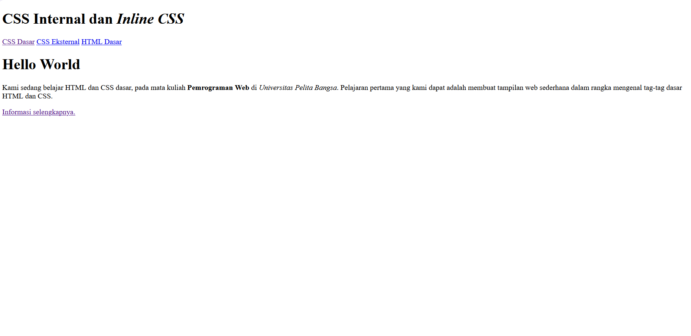
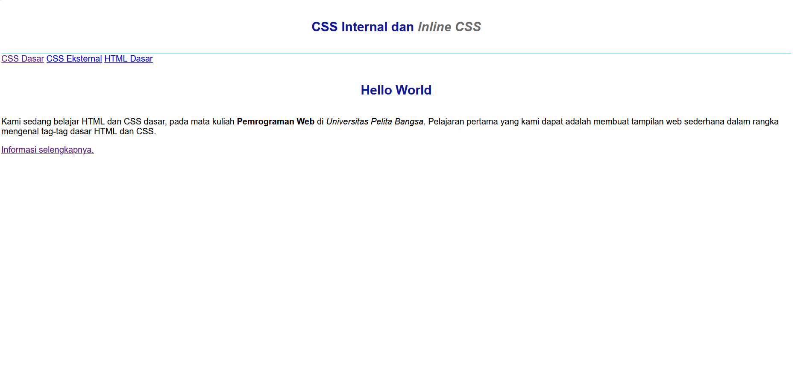
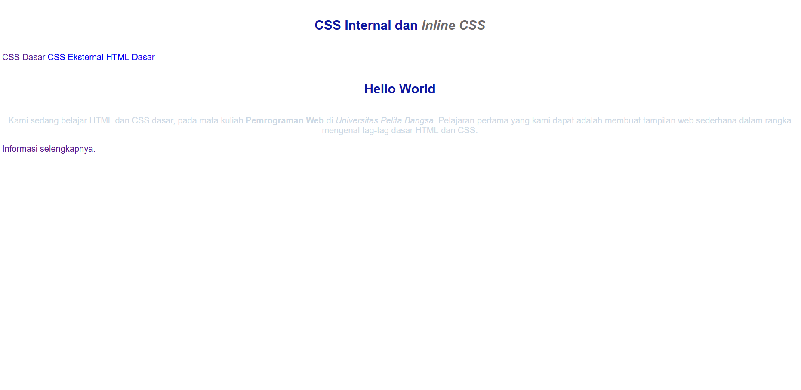
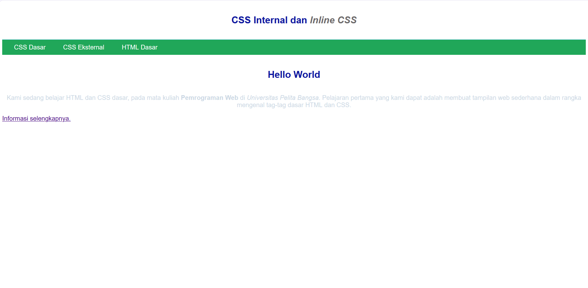
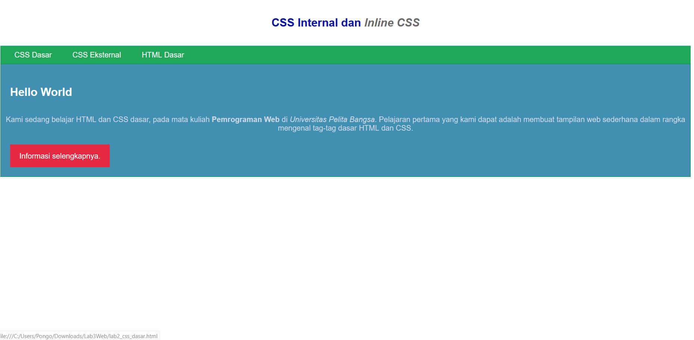
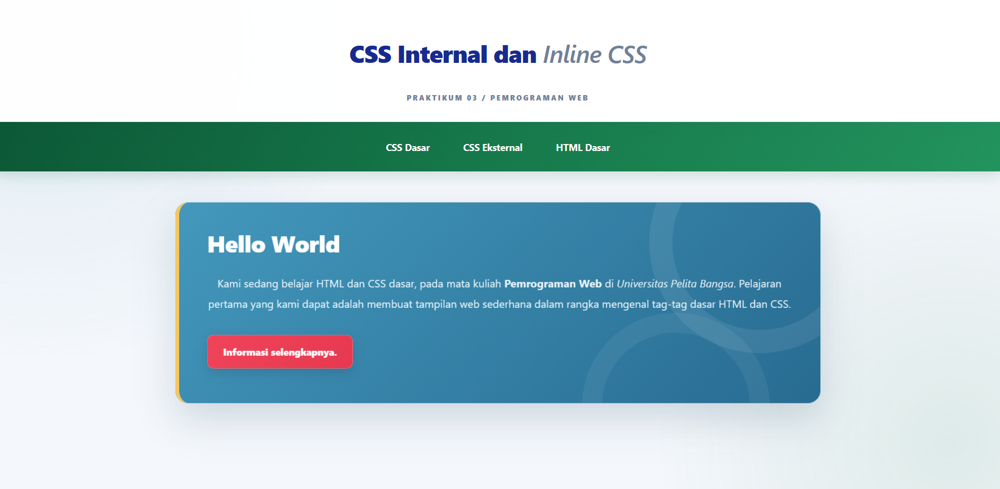

# Laporan Praktikum 3 — CSS Dasar

## Identitas Mahasiswa
- **Nama:** Muhammad Farhan Lutfi Hakim
- **NIM:** 312310570
- **Program Studi** TEKNIK INFORMATIKA
- **Mata Kuliah:** Pemrograman Web
- **Praktikum:** 3 — CSS Dasar

## A. Tujuan Praktikum
Berdasarkan modul Praktikum 3: CSS Dasar, tujuan praktikum ini adalah:
1. Memahami konsep dasar CSS.
2. Memahami aturan penulisan CSS.
3. Memahami selector sebagai pengontrol CSS.
4. Membuat pengaturan CSS pada HTML.

## B. Dasar Singkat
CSS (*Cascading Style Sheets*) digunakan untuk mengatur tampilan elemen HTML. Pada praktikum ini, CSS diterapkan melalui tiga cara:
- **Internal CSS:** aturan CSS ditulis di dalam elemen `<style>` pada bagian `<head>`.
- **Inline CSS:** aturan CSS ditulis melalui atribut `style` pada elemen HTML.
- **External CSS:** aturan CSS ditulis dalam file `.css` terpisah dan dihubungkan dengan elemen `<link>`.

Praktikum juga menggunakan selector elemen, ID, dan class.

## C. Langkah Praktikum dan Dokumentasi

### 1. Membuat dokumen HTML
Membuat file `lab2_css_dasar.html` yang berisi struktur HTML, judul, navigasi, bagian `Hello World`, paragraf, dan tautan informasi.

**Dokumentasi:**



### 2. Menambahkan CSS internal
CSS internal ditambahkan di bagian `<head>` menggunakan elemen `<style>`. Aturan mengatur jenis huruf halaman, tampilan header, ukuran judul, warna judul, perataan teks, dan warna teks miring.

**Dokumentasi:**



### 3. Menambahkan inline CSS
Atribut `style` ditambahkan pada elemen paragraf untuk mengatur perataan dan warna teks. Contoh yang digunakan:

```html
<p style="text-align: center; color: #eaf5fb;">
```

**Dokumentasi:**



### 4. Membuat CSS eksternal
File `style_eksternal.css` dibuat untuk mengatur navigasi, warna tautan, jarak, dan efek ketika kursor diarahkan ke tautan. File CSS dihubungkan ke HTML menggunakan:

```html
<link rel="stylesheet" href="style_eksternal.css" type="text/css">
```

**Dokumentasi:**



### 5. Menambahkan ID selector dan class selector
ID selector `#intro` digunakan untuk mengatur area konten utama dan judul di dalamnya. Class selector `.button` dan `.btn-primary` digunakan untuk mengatur tampilan tautan sebagai tombol.

**Dokumentasi:**



### 6. Eksperimen CSS
Eksperimen dilakukan dengan menyempurnakan warna, tipografi, jarak, sudut elemen, bayangan, efek hover, transisi, dan penyesuaian tampilan untuk layar kecil menggunakan media query. Perubahan diterapkan pada `style_eksternal.css`.

**Dokumentasi:**



> Pastikan setiap gambar di atas benar-benar sudah disimpan pada folder `screenshots` dengan nama yang sesuai. Jika nama file berbeda, sesuaikan tautan gambar pada README ini.

## D. Jawaban Pertanyaan dan Tugas

### 1. Lakukan eksperimen dengan mengubah dan menambah properti serta nilai CSS.
Eksperimen dilakukan dengan mengubah warna latar, ukuran teks, jarak elemen, sudut elemen, bayangan, dan efek interaksi. Properti `background` digunakan untuk mengatur latar, `padding` untuk mengatur jarak antara isi dan batas elemen, `border-radius` untuk membulatkan sudut, serta `box-shadow` untuk memberikan bayangan. Properti `transition` dan `transform` digunakan untuk menambahkan efek perubahan ketika kursor diarahkan ke elemen. Media query `@media` digunakan untuk menyesuaikan tampilan pada layar yang lebih kecil.

Perubahan yang diamati adalah tampilan halaman menjadi lebih terstruktur, memiliki konsistensi warna, dan lebih responsif. Dokumentasi hasil eksperimen ditampilkan pada screenshot keenam.

### 2. Apa perbedaan deklarasi CSS `h1 { ... }` dengan `#intro h1 { ... }`?
Selector `h1` berlaku pada semua elemen `<h1>` di halaman HTML. Sebaliknya, selector `#intro h1` hanya berlaku pada elemen `<h1>` yang berada di dalam elemen dengan `id="intro"`.

Contoh:

```css
h1 {
    color: blue;
}

#intro h1 {
    color: white;
}
```

Pada contoh tersebut, semua judul `<h1>` secara umum berwarna biru. Namun, judul `<h1>` di dalam `#intro` berwarna putih karena selector `#intro h1` lebih spesifik.

### 3. Apabila ada CSS internal, eksternal, dan inline pada elemen yang sama, deklarasi manakah yang ditampilkan browser? Jelaskan dan berikan contoh.
Dalam kondisi umum, deklarasi inline pada atribut `style` memiliki prioritas lebih tinggi daripada deklarasi internal dan eksternal biasa apabila semuanya mengatur properti yang sama. Namun, hasil akhir tetap mengikuti mekanisme CSS cascade, termasuk tingkat kepentingan, specificity, asal deklarasi, dan urutan aturan.

Contoh:

```html
<style>
    p {
        color: blue;
    }
</style>

<p style="color: red;">Belajar CSS</p>
```

Teks “Belajar CSS” akan berwarna merah karena deklarasi inline menetapkan `color: red`, sedangkan CSS internal menetapkan `color: blue`. Jika deklarasi inline dihilangkan, hasilnya ditentukan oleh aturan internal dan eksternal yang berlaku, termasuk specificity dan urutan deklarasi.

### 4. Pada elemen HTML terdapat ID dan class. Jika masing-masing selector memiliki deklarasi CSS, deklarasi manakah yang ditampilkan browser?
Selector ID umumnya memiliki specificity lebih tinggi daripada selector class. Oleh karena itu, jika kedua selector mengatur properti yang sama dengan deklarasi biasa dan tidak ada faktor cascade lain yang mengubah prioritasnya, deklarasi ID akan menang.

Contoh sesuai pola soal:

```html
<p id="paragraf-1" class="text-paragraf">
    Contoh paragraf
</p>
```

```css
#paragraf-1 {
    color: red;
}

.text-paragraf {
    color: blue;
}
```

Teks akan berwarna merah karena selector `#paragraf-1` lebih spesifik daripada `.text-paragraf`. Class tetap dapat mengatur properti lain yang tidak ditetapkan oleh selector ID. Hasil akhir juga dapat dipengaruhi oleh `!important` dan aturan cascade lainnya.

## E. Struktur Folder Proyek

```text
Lab3Web/
├── lab2_css_dasar.html
├── style_eksternal.css
├── README.md
└── screenshots/
    ├── 01-html-awal.png
    ├── 02-css-internal.png
    ├── 03-inline-css.png
    ├── 04-css-eksternal.png
    ├── 05-id-class-selector.png
    └── 06-eksperimen-css.png
```

## F. Validasi CSS
File `style_eksternal.css` diperiksa menggunakan W3C CSS Validation Service. Berdasarkan hasil pemeriksaan yang diperoleh, validasi file CSS eksternal berhasil tanpa error.

Tautan validator: https://jigsaw.w3.org/css-validator/

## G. Kesimpulan
Praktikum ini membahas penerapan CSS internal, inline, dan eksternal pada dokumen HTML. Praktikum juga menunjukkan penggunaan selector elemen, ID, dan class untuk mengatur tampilan elemen. Eksperimen CSS memperlihatkan bahwa properti warna, tipografi, jarak, bayangan, transisi, dan media query dapat digunakan untuk membuat halaman lebih konsisten dan responsif. Prioritas deklarasi ditentukan oleh mekanisme cascade, specificity, tingkat kepentingan, dan urutan deklarasi.


